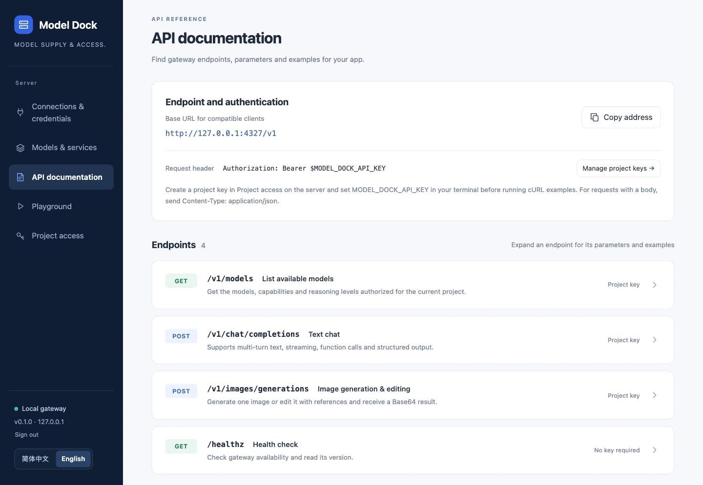
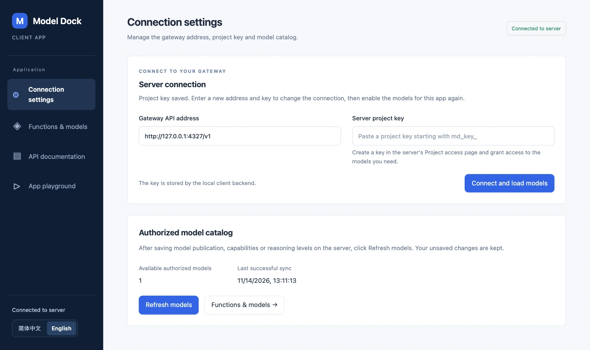
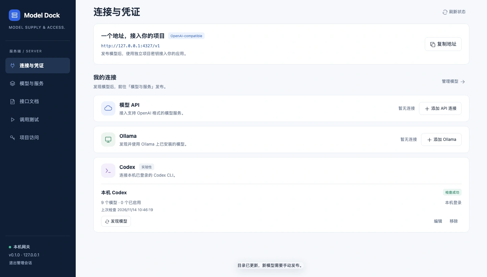
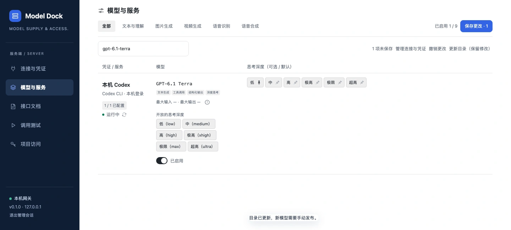
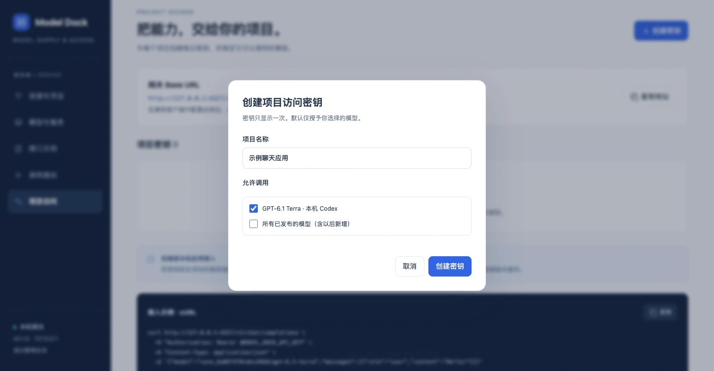
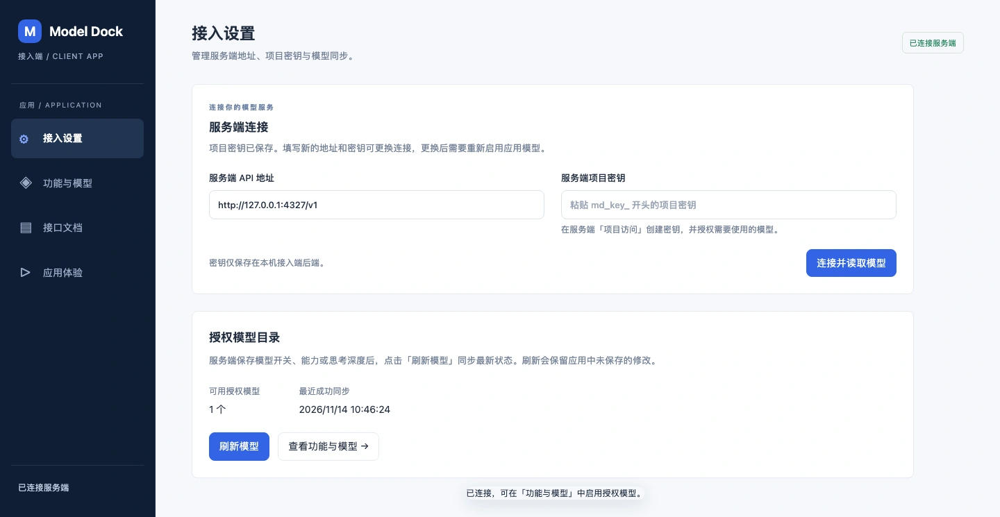
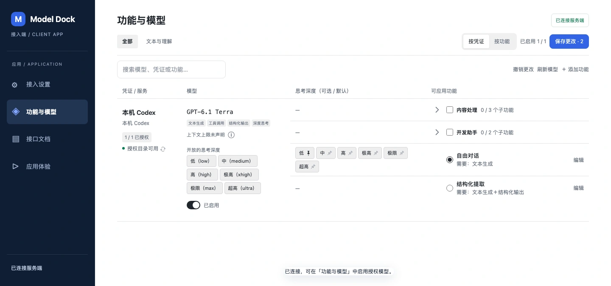
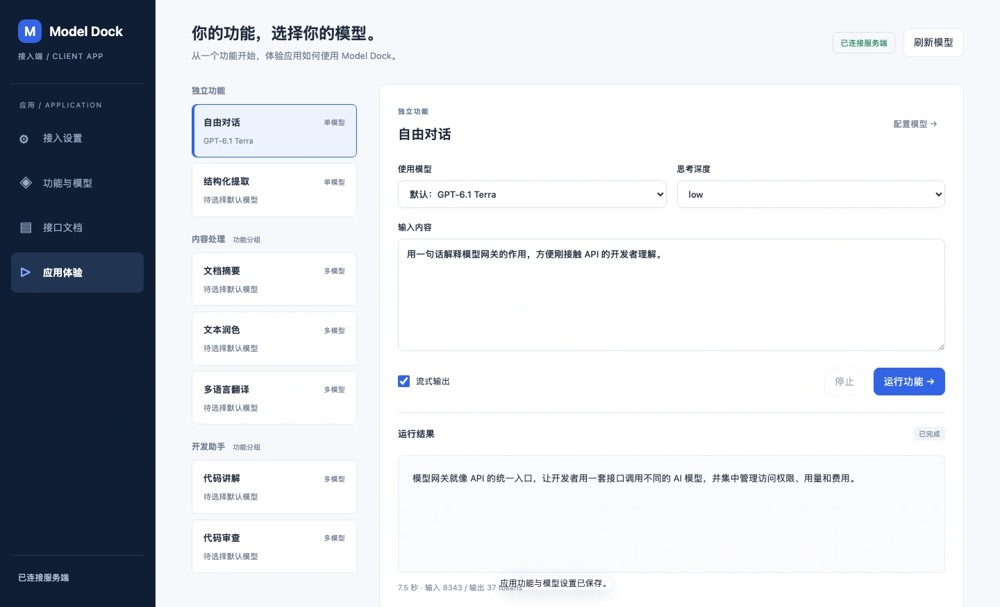
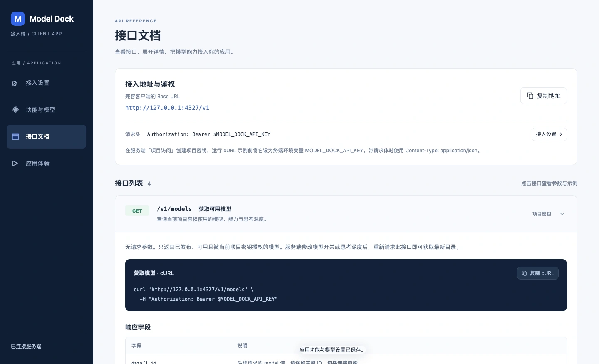

# Model Dock

**English** | [简体中文](README.zh-CN.md)

**Your models. Connected.** A local-first model gateway with a separate client demo.

Connect your own model APIs, Ollama, and a signed-in Codex CLI through a single endpoint. The server owns model supply, credentials, publication, project access and request controls. Consuming apps own their features, groups and model preferences. The gateway, console and demo have no third-party runtime dependencies; the core, protocols, and provider adapters are maintained in this repository.

## Quick start

Requires **Node.js 22.12+**. Node.js 24 LTS is recommended.

On macOS, double-click **Start Model Dock.command** in the project folder. When the service is ready, your default browser opens **Connections & Credentials** and signs in automatically. Double-click it again to reopen the console while the service is running.

To start from a terminal:

```sh
git clone https://github.com/idea007/model-dock.git
cd model-dock
npm ci
npm start
```

The console runs at **http://127.0.0.1:4317** by default. The API base URL is **http://127.0.0.1:4317/v1**.

The terminal startup also opens and signs in to the console automatically. Use `npm start -- --no-open` to run the service without opening a browser. The gateway listens only on loopback.

While the gateway is running, use `npm run console` to reopen and sign in to the console. To open it in a specific browser, run `npm run --silent console -- --print` and paste the one-time URL into its address bar. Tabs at the same address share the sign-in within that browser for up to seven days. Restarting the gateway automatically opens the console and signs in again, unless `--no-open` is used.

The screenshots use a separate local instance on ports 4327 and 4328. When following the steps, copy the Base URL shown in your own console.

Use **简体中文 / English** at the bottom of the sidebar in either app. Each app remembers its language in the current browser.

**Server console** with English selected



**Client app** with English selected



### 1. Add a model source

In **Connections & credentials** (`连接与凭证`), save a provider credential under **Model API** or a loopback address under **Local services**. Enter a local service token if the service requires one. In **Models & services → Add service**, choose the saved connection or credential and select a protocol. For Ollama or Codex, save the connection and click **Discover models** (`发现模型`) on its card.



### 2. Publish a model

Open **Models & services** (`模型与服务`) and turn on the switch for the model you want to publish. Newly discovered models start disabled. For models with reasoning levels, choose which levels to expose and use the pin to set the default. Click **Save changes** (`保存更改`) in the upper right to publish. You can try the model under **Playground** (`调用测试`) by selecting it, entering a prompt, and clicking **Send request** (`发送请求`).



### 3. Create a project key

Under **Project access** (`项目访问`), click **Create key** (`创建密钥`), enter a project name, and select the published models the project may call. Create the key and copy the full `md_key_…` value while it is visible. Also copy the gateway Base URL from this page.



## Try the independent client demo

```sh
npm run demo -- --open
```

Start the client in a second terminal while the gateway is running. The client opens directly at **http://127.0.0.1:4318** and shows an empty model catalog until you connect it.

### 1. Connect to the gateway

In **Connection settings** (`接入设置`), paste the gateway Base URL, including `/v1`, and the `md_key_…` project key. Click **Connect and load models** (`连接并读取模型`). Check that **Connected to server** (`已连接服务端`) appears and that the authorized model count matches the project's access. After publishing models or changing capabilities or reasoning levels on the server, use **Refresh models** (`刷新模型`) to sync them.



### 2. Assign a model to a feature

Open **Functions & models** (`功能与模型`), enable the model for this client, and select **Free chat** (`自由对话`) in the model's feature column. Click **Save changes** (`保存更改`). For features with multiple candidates, select the allowed models and pin the one to use by default. You can switch between the credential and feature views. [Model preference guide](docs/model-settings.md)



### 3. Run the feature

In **Application experience** (`应用体验`), select **Free chat**, keep the default model or pick an allowed candidate, and enter a prompt. Click **Run feature** (`运行功能`) to see the reply under **Result** (`运行结果`). Calls use the selected provider's resources. [Client setup](docs/client-demo.md)



| Server console · 4317 | Client demo · 4318 |
| --- | --- |
| Provider connections and upstream secrets | Project connection and authorized catalog |
| Model publication and project scopes | App model choices, feature groups and defaults |
| Capacity, timeout, revocation and request metadata | Prompt templates, per-feature reasoning and user interactions |

Existing server aliases remain compatible with existing keys and calls. New application functions belong in clients; the gateway no longer creates global business aliases.

## Connect your app

Open **API documentation** (`接口文档`) in either sidebar for parameters, response examples and cURL. The client page uses the saved gateway address and authorized model IDs. Run `GET /v1/models` with your project key to get a model's full `data[].id`. To import the API into a client tool, download [OpenAPI 3.1](docs/openapi.json) from the repository or open `/openapi.json` on either local app. [API reference](docs/api.md)



```sh
export MODEL_DOCK_API_KEY='your-project-key-from-the-console'
export MODEL_DOCK_BASE_URL='http://127.0.0.1:4317/v1'
curl "$MODEL_DOCK_BASE_URL/models" -H "Authorization: Bearer $MODEL_DOCK_API_KEY"

# Use the full ID of a text model returned above.
export MODEL_DOCK_MODEL='connection-id/model-id'
node examples/chat.mjs
```

Use raw HTTP or an OpenAI-compatible SDK. Start with `chat.completions.create()` for message-based clients or use `responses.create()` with caller-supplied history. [Responses quick start](docs/api.md#responses)

```js
import OpenAI from 'openai';

const client = new OpenAI({
  baseURL: process.env.MODEL_DOCK_BASE_URL || 'http://127.0.0.1:4317/v1',
  apiKey: process.env.MODEL_DOCK_API_KEY,
  maxRetries: 0,
});
const result = await client.chat.completions.create({
  model: process.env.MODEL_DOCK_MODEL,
  messages: [{ role: 'user', content: 'Hello' }],
});
const { content, refusal } = result.choices[0].message;
console.log(refusal ?? content);
```

Keep project keys in your application's server-side environment variables. [Plain JavaScript example](examples/chat.mjs) · [Python SDK example](examples/chat.py)

### Function calling

Use a published model that supports tools and grant it to your project key. Start with `tool_choice: "auto"` and `parallel_tool_calls: false` on OpenAI-compatible APIs, Ollama or Codex. The app executes the function and sends the result in the next request. Chat matches the result by `tool_call_id`. Responses uses `call_id` and keeps the history in the client with `store: false`. [Examples for both endpoints](docs/api.md#function-calling) · [Runnable Chat example](examples/tools.mjs)

## Three model sources

| Source | Connection | Capabilities |
| --- | --- | --- |
| Your own API | OpenAI-compatible base URL + API key | Multiple connections, model discovery or manual registration, publication controls and project access scopes |
| Ollama | Native local HTTP API | Installed-model discovery, capability and context metadata, text inference, streaming, JSON, and model-supported tool calls |
| Codex (experimental) | Locally installed and signed-in CLI / App Server | Model catalog, text and tool calls, image generation and reference-based editing |

Install and start Ollama separately, then download a model with a command such as `ollama pull <model>`. Model Dock does not download weights at startup or during status checks. Context metadata is displayed for reference; inference does not automatically raise `num_ctx` to the model's maximum.

Codex uses native JSON-RPC and creates a temporary thread for each request. Shell, browser, plugin, and host MCP capabilities are isolated. Application tool calls are returned to the caller for execution; the gateway does not execute them on the app's behalf. This is a real model bridge using the account or upstream configured in Codex and its associated quota. `model/list` is only a catalog and does not establish that the current account can run a particular model.

Discover models on the Codex connection and publish `codex-imagegen` under **Models & services → Image generation**. In the playground, add up to five reference images, request an aspect ratio or a transparent background, or use **Continue editing**. Grant your project key access to the image model. Use the OpenAI SDK's `images.generate()` for basic generation and the Model Dock JSON extension `reference_images` on `POST /v1/images/generations` for edits. Requests use the signed-in Codex account's quota. [Image API and runnable edit example](docs/api.md#images)

Codex inherits `HTTPS_PROXY` / `HTTP_PROXY` / `ALL_PROXY` from the environment that starts the gateway. When no proxy is explicitly configured, macOS detects enabled system HTTP/HTTPS proxies on loopback and passes them only to the Codex child process, without changing system settings. PAC and non-loopback proxies are not imported automatically; set the environment variables explicitly on other platforms or for custom networks. If model listing works but inference keeps reconnecting, check the CLI's proxy connection first.

Built-in Codex authentication has a different scope from hosted services. For commercial or hosted use, evaluate the official API or Sign in with ChatGPT separately. This release does not implement Sign in with ChatGPT or provide shared-account resale or public proxy deployment. [Official App Server documentation](https://learn.chatgpt.com/docs/app-server#auth-endpoints) · [Sign in with ChatGPT](https://developers.openai.com/siwc)

## Compatibility

- `GET /v1/models`
- `POST /v1/audio/speech`, `POST /v1/audio/transcriptions`, `POST /v1/embeddings`, and `/v1/videos` use published provider service IDs. Submit, poll, and download video jobs with the owning project key. [Audio and embeddings examples](docs/api.md#audio-and-embeddings) · [Video endpoints](docs/api.md#video-generation)
- `POST /v1/chat/completions` accepts text and ordered content parts, with one choice per request. It supports JSON, SSE, explicit refusals, and function calls with result replay. SSE delivers tool calls after the full batch passes validation.
- `POST /v1/responses` supports stateless text, SSE and up to one function call per turn on tool-capable models across OpenAI-compatible APIs, Ollama and Codex. Use `sdk.responses.create()` and carry forward history in `input` with `store: false`. The calling app executes the function. [Responses examples](docs/api.md#responses)
- Vision-capable models on all three adapters can read PNG, JPEG or WebP Base64 data URLs in user messages. Use `image_url` with Chat Completions or `input_image` with Responses. Omit `detail` or set it to `auto`. Images and history count toward the 2 MiB JSON limit. [Image input examples](docs/api.md#image-input)
- `POST /v1/images/generations`: one Base64-encoded image from Codex, with optional reference images.
- Token usage as reported by the upstream. Missing usage stays unknown rather than being fabricated as zero.
- Client disconnects and cancellation, request timeouts, concurrency limits, and project-key revocation.
- Management APIs for connections, catalogs, model publication, deployment pools, project keys, and cancellation of in-flight requests.

**Compatibility covers the documented subset.** Unsupported parameters return errors. For example, Codex rejects `temperature` and `max_tokens`. On a `429`, inspect `error.code` to distinguish gateway capacity from provider rate limits. See the [compatibility matrix](docs/compatibility.md), [errors and retries](docs/api.md#errors-and-retries) and [management API](docs/api.md#management).

Later work includes audio and video capabilities, remote device pairing, and Ollama model management. [Roadmap](docs/roadmap.md)

## Data and configuration

Data is stored in the current user's `~/.model-dock` by default. Set `MODEL_DOCK_HOME` to use a dedicated directory. Only one gateway process may write to a directory at a time.

- `state.json` stores connections, models, deployment pools, compatible legacy aliases, hashed project keys, and upstream keys encrypted with AES-256-GCM.
- `master.key`: the decryption key. `admin.token`: the local administrator token.
- POSIX file permissions are `0600`, and directory permissions are `0700`. On Windows, use a directory private to the current user and configure the corresponding ACLs.
- Atomic writes and revision checks prevent concurrent overwrites. Reading a corrupted configuration does not reset it.
- **Usage → AI call records** shows 30 days of local calls with task grouping, filters, individual details and CSV export. **AI usage** adds chart filters, usage breakdowns, model prices and Provider statement reconciliation.
- The standard `usage/` ledger contains call metadata and measured usage. `MODEL_DOCK_USAGE_DEBUG=1` enables separately stored, redacted development details for new calls. [Local usage and reconciliation](docs/api.md#project-limits-budgets-and-local-usage)
- `budgets.json` stores monthly budget balances and active reservations using local model prices.

Set request limits and an optional monthly budget per key in **Project access**. The budget reserves estimated cost before each call and settles against reported usage. Enter a price in the same currency under **Usage**. [Budget and pricing rules](docs/api.md#project-limits-budgets-and-local-usage)

In **Models & services**, publish a deployment pool to route requests across deployments of the same model. Grant the pool ID to a project key to use it. The gateway selects by current concurrency and skips connections in cooldown. [Deployment pool setup](docs/api.md#deployment-pools)

Back up the entire data directory together. The encryption key and data reside on the same machine, so this does not protect against someone who already has access to the current OS account. Do not commit this directory to Git, sync it to untrusted accounts, or share it publicly.

```sh
# macOS / Linux
MODEL_DOCK_PORT=4320 MODEL_DOCK_HOME=/path/to/private/data npm start
```

Copy `.env.example` and `.env.local.example` to `.env` and `.env.local` for gateway defaults and machine-specific overrides. In descending priority, the gateway reads the process environment, `.env.local`, and `.env`. Files are resolved in the Model Dock installation or source directory. Set `MODEL_DOCK_CONFIG_DIR` to select another directory. Save provider keys and service tokens in Connections & credentials. Projects use the gateway address and their own project key.

In PowerShell, set process variables with syntax such as `$env:MODEL_DOCK_PORT='4320'`.

## Manage local MFLUX

On Apple Silicon macOS, prepare the Python environment and the models you want to serve.

```sh
npm run mflux -- setup
npm run mflux -- preload --model flux2-klein-4b
npm run mflux -- preload --model z-image-turbo
npm run mflux -- start
npm run mflux -- health
```

Use `npm run mflux -- stop` or `npm run mflux -- restart` to control the user LaunchAgent. With an installed package, replace `npm run mflux --` with `model-dock mflux`. The runtime listens on loopback port `8016` by default and runs independently of the gateway within the current macOS login. Startup uses the existing weights in offline mode.

In Connections & credentials, register an MFLUX connection at `http://127.0.0.1:8016/v1` using the token from the private `runtimes/mflux/service-token` file inside the Model Dock data directory. Publish the discovered models and grant them to the appropriate project. For an existing installation, reuse its prepared runtime directory via `MODEL_DOCK_MFLUX_RUNTIME_DIR` or move that directory to `runtimes/mflux` under the Model Dock data directory after stopping the old process. Keep the original service token with the data if retaining the existing connection.

## Manage local speech and transcription

On Apple Silicon macOS, prepare the shared MLX Audio Python environment and cache Kokoro and Whisper. Use Python 3.12 and make FFmpeg available on the command path for video transcription, speech alignment, and reference audio.

```sh
npm run tts -- setup
npm run tts -- preload
npm run asr -- preload
npm run tts -- start
npm run asr -- start
npm run tts -- health
npm run asr -- health
```

Each command also supports `stop` and `restart`. The installed CLI uses `model-dock tts` and `model-dock asr`. Both user LaunchAgents start offline in the current macOS login and use the shared `runtimes/mlx-audio` directory under the private Model Dock data directory. Set `MODEL_DOCK_MLX_AUDIO_RUNTIME_DIR` to reuse a prepared directory. Whisper also supplies optional speech alignment.

Register the `speech` upstream at `http://127.0.0.1:7720/v1` and the `transcription` upstream at `http://127.0.0.1:7732/v1`, then publish and authorize the deployments in Project access. Existing deployments on these ports can keep their IDs and grants. For reference speech, TTS preload accepts `--model mlx-community/MOSS-TTS-Nano-100M` and the supported 0.6B or 1.7B Qwen3-TTS Base 8-bit model names.

## Development and packaging

```sh
npm ci
npm run verify       # Syntax, protocol boundaries, HTTP integration, official SDK, and DOM tests
npm run pack:check   # Package, install in isolation, and verify the installed CLI and static assets
npm pack
```

Install a locally built package:

```sh
npm install --global ./lab-model-dock-0.1.0.tgz
model-dock serve
model-dock-demo --open
```

Source repository: [idea007/model-dock](https://github.com/idea007/model-dock). The npm package name is `lab-model-dock`; it has not been published to npm. The installation command above uses a locally generated tarball. Building does not require the original blog repository, its database, or its environment files.

Automated tests use local HTTP/JSON-RPC fixtures. They do not read a real Codex account or call paid models. CI covers Node.js 22/24 on macOS, Linux, and Windows; refer to the CI runs for actual results.

See the [verification record](docs/verification.md) for the initial test results, real Ollama/Codex calls, and remaining verification boundaries.

```text
apps/gateway/       CLI, HTTP, and static asset entry points
apps/console/       Server management console with no build step
apps/demo/          Independent consuming app, private settings and gateway UI
packages/core/      Persistence, authorization, catalogs, routing, and request controls
packages/protocol/  Validation, errors, and streaming protocol
packages/providers/ OpenAI-compatible, Ollama, and Codex adapters
examples/           Standalone client examples
tests/              Offline protocol and integration tests
```

See the [architecture and extraction boundaries](docs/architecture.md), [contributing guide](CONTRIBUTING.md), and [security notes](SECURITY.md).

## License

MIT. See [NOTICE](NOTICE) for provenance and extraction scope. This project does not distribute Codex, Ollama, or any model weights; their respective licenses and service terms apply independently.
