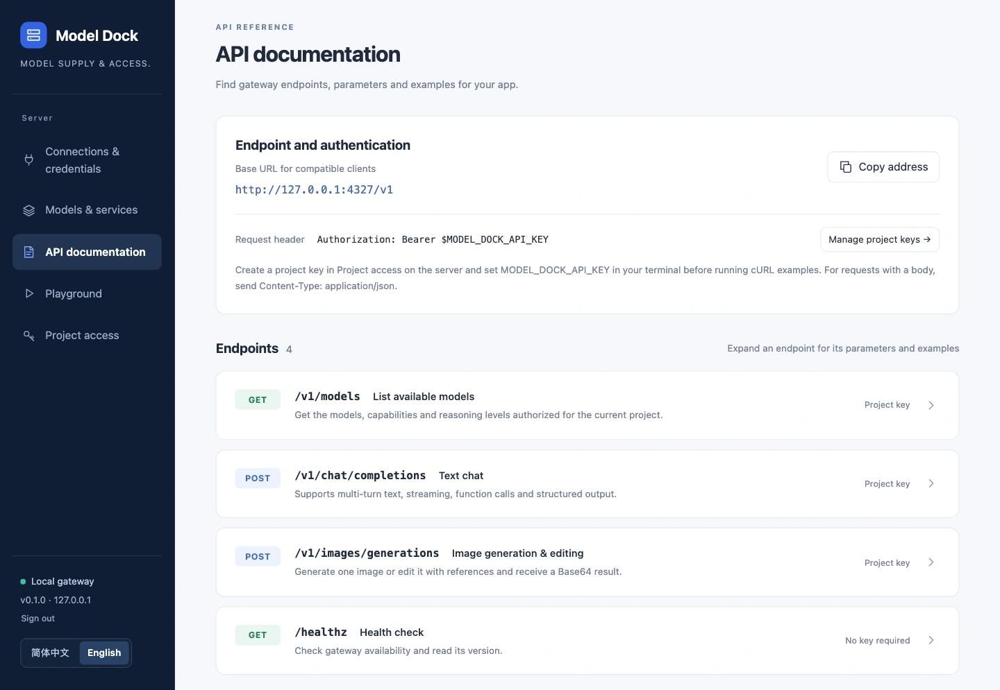
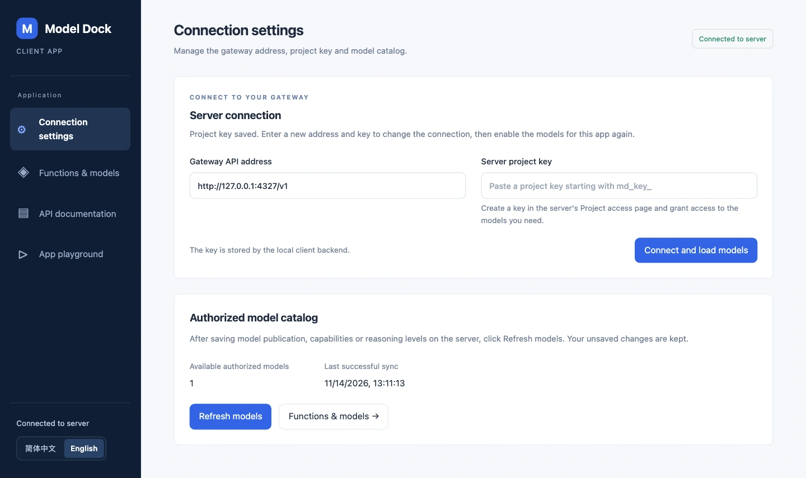
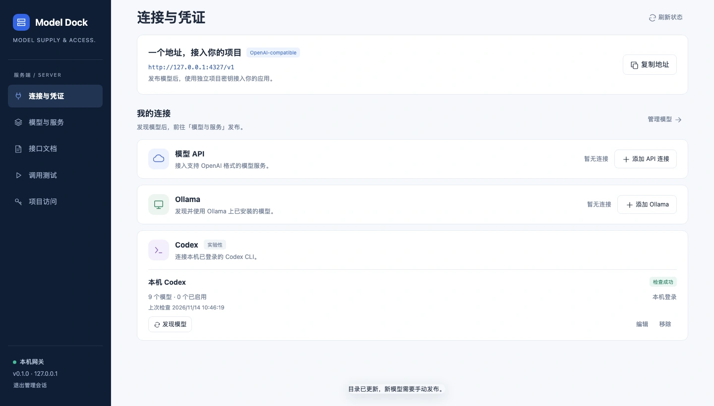
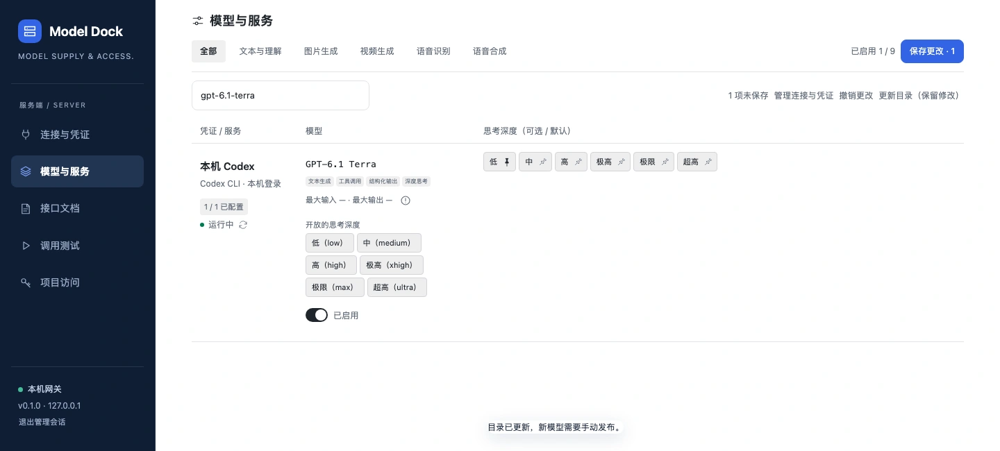
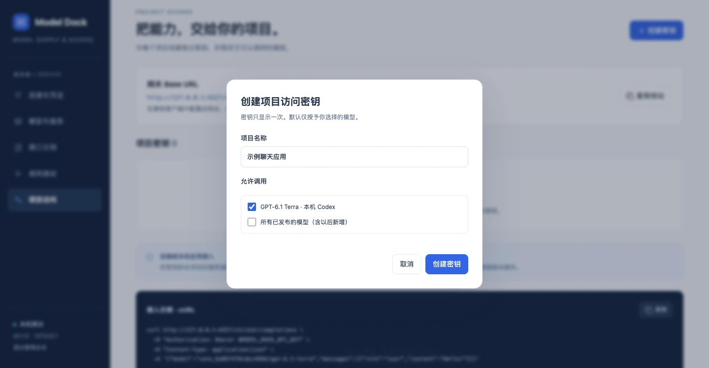
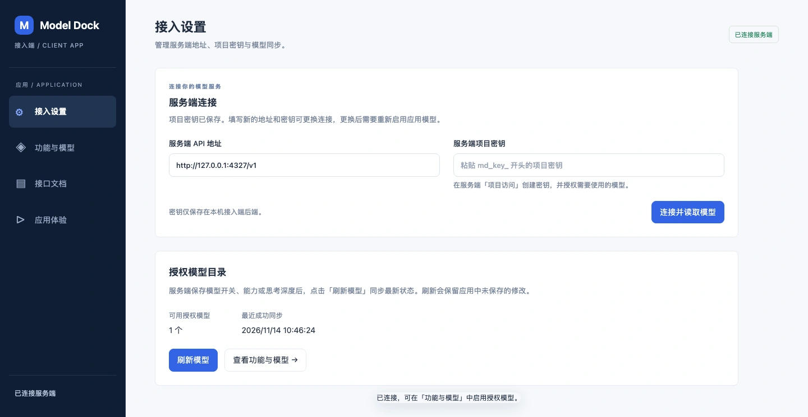
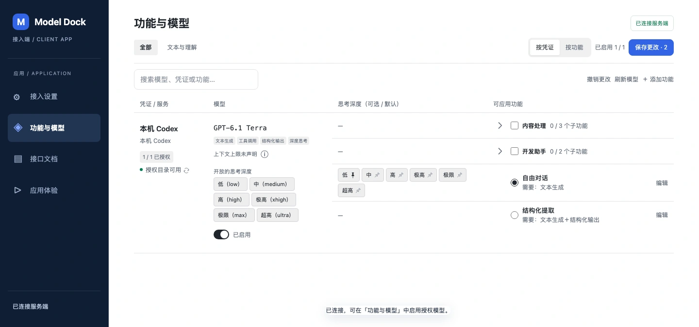
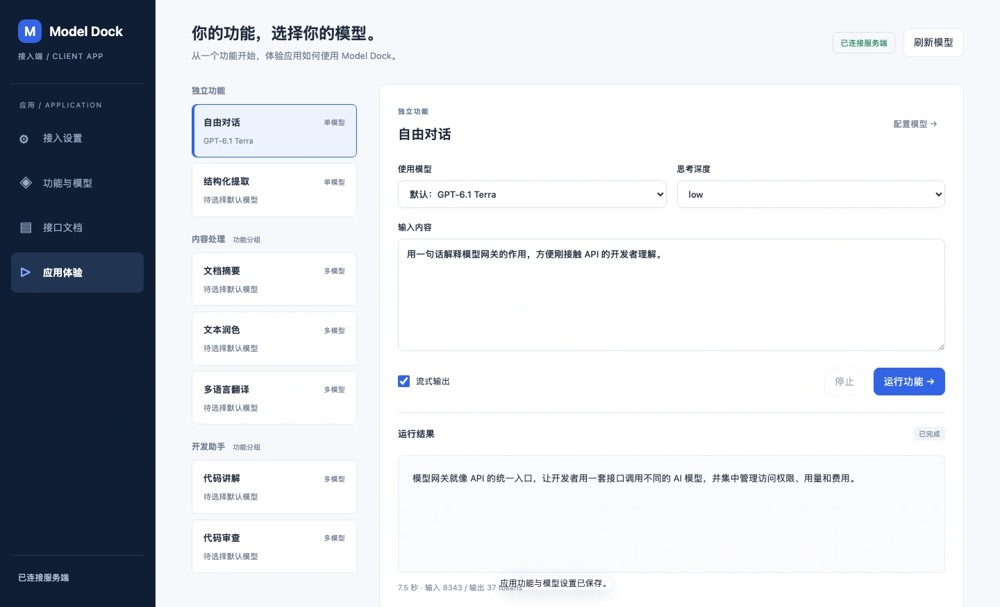
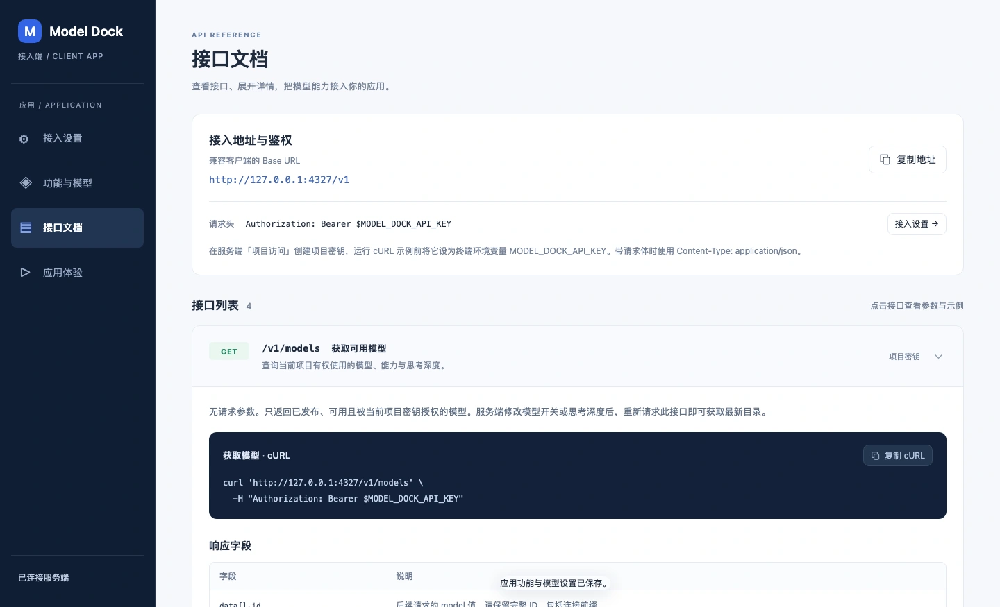

# Model Dock

[English](README.md) | **简体中文**

**Your models. Connected.** 本地优先的模型网关，配套独立接入端 demo。

把自己的模型 API、Ollama 和已登录的 Codex CLI 接入同一个地址，由服务端统一管理模型供给、凭证、发布、项目授权和调用控制；接入应用管理自己的功能、分组与模型偏好。网关、管理台和 demo 无需运行时第三方依赖；核心、协议和适配器放在同一仓库中维护。

## 快速开始

需要 **Node.js 22.12+**，推荐 Node.js 24 LTS。

在 macOS 的项目目录中双击 **Start Model Dock.command**。服务就绪后，默认浏览器会自动登录并打开「连接与凭证」。服务已在运行时，再次双击即可重新打开管理台。

也可以从终端启动。

```sh
git clone https://github.com/idea007/model-dock.git
cd model-dock
npm ci
npm start
```

管理台默认位于 **http://127.0.0.1:4317**，API Base URL 为 **http://127.0.0.1:4317/v1**。

从终端启动也会自动打开并登录管理台。仅需运行服务时，使用 `npm start -- --no-open`。网关只监听本机地址。

服务运行期间可用 `npm run console` 重新打开并登录管理台。如需在指定浏览器中打开，运行 `npm run --silent console -- --print`，把生成的一次性链接粘贴到地址栏。同一浏览器中打开相同地址会沿用登录状态，最长有效期为 7 天；重启网关会自动打开管理台并重新登录（使用 `--no-open` 时除外）。

截图使用端口为 4327 和 4328 的独立本机实例。实际操作时，从自己的管理台复制 Base URL。

服务端和接入端都可在侧栏底部切换「简体中文 / English」，两个页面各自在当前浏览器记住语言选择。

**服务端切换到英文后**



**接入端切换到英文后**



### 1. 添加模型来源

在「连接与凭证」的「模型 API」保存供应商凭证，或在「本机服务」保存本机地址。服务启用鉴权时填入它的访问令牌。然后到「模型与服务」点击「添加服务」，选择已保存的连接或凭证，再选择服务协议。接入 Ollama 或 Codex 时，保存连接后在对应卡片点击「发现模型」。



### 2. 发布模型

在「模型与服务」找到要提供给项目的模型，打开发布开关。新发现的模型默认关闭。模型支持思考深度时，可以选择开放等级并用图钉设定默认值。在右上角点击「保存更改」完成发布。想先试用模型，可以打开「调用测试」，选中已发布模型，填写提示词后点击「发送请求」。



### 3. 创建项目密钥

在「项目访问」点击「创建密钥」，填写项目名称，勾选这个项目需要访问的已发布模型。创建后及时复制完整的 `md_key_…` 密钥，关闭后无法再次查看。在同一页复制网关 Base URL。



## 体验独立接入端 demo

```sh
npm run demo -- --open
```

保持网关运行，在另一个终端启动接入端。接入端默认可直接打开 **http://127.0.0.1:4318**，连接服务端后才会显示授权模型。

### 1. 连接服务端

在左侧「接入设置」填入包含 `/v1` 的网关 Base URL 和项目密钥，点击「连接并读取模型」。确认右上角显示「已连接服务端」，下方显示授权模型数量。服务端调整模型发布、能力或思考深度后，可在此处点击「刷新模型」同步。



### 2. 给功能分配模型

进入「功能与模型」，启用本应用要用的模型，在该模型的「可应用功能」列选中「自由对话」，然后点击「保存更改」。如果某个功能允许多个候选，可以勾选候选模型，并点击图钉指定默认模型。也可以切换到「按功能」视图配置。[功能与模型设置](docs/model-settings.zh-CN.md)



### 3. 运行功能

打开「应用体验」，选择「自由对话」，使用默认模型或手动选择已配置的候选，输入提示词并点击「运行功能」。回复会显示在「运行结果」中。调用会使用所选模型来源的资源和额度。[接入端启动说明](docs/client-demo.zh-CN.md)



| 服务端管理台 · 4317 | 接入端 demo · 4318 |
| --- | --- |
| 模型来源和上游凭证 | 项目连接与授权目录 |
| 模型发布与项目访问范围 | 应用模型选择、功能分组与默认值 |
| 并发、超时、撤权及请求记录 | 提示模板、功能思考偏好与用户交互 |

已有服务端别名及其项目调用继续兼容；新业务功能由接入端维护，网关不再创建全局业务别名。

## 接入自己的项目

服务端和接入端左侧都有「接口文档」。展开接口可查看参数、响应和 cURL 示例。接入端示例使用已保存的网关地址和项目授权的模型 ID。也可用项目密钥请求 `GET /v1/models`，从 `data[].id` 取得完整 ID。两端本地服务的 `/openapi.json` 都可下载 [OpenAPI 3.1 规范](docs/openapi.json)，用于导入 API 工具。[API 文档](docs/api.md)



```sh
export MODEL_DOCK_API_KEY='从管理台创建的项目密钥'
export MODEL_DOCK_BASE_URL='http://127.0.0.1:4317/v1'
curl "$MODEL_DOCK_BASE_URL/models" -H "Authorization: Bearer $MODEL_DOCK_API_KEY"

# 使用上面接口返回的文本模型完整 ID。
export MODEL_DOCK_MODEL='connection-id/model-id'
node examples/chat.mjs
```

可以使用原生 HTTP 或 OpenAI 兼容 SDK。使用 `chat.completions.create()` 发送消息，或使用 `responses.create()` 由调用方带回历史。[Responses 快速接入](docs/api.md#responses)

```js
import OpenAI from 'openai';

const client = new OpenAI({
  baseURL: process.env.MODEL_DOCK_BASE_URL || 'http://127.0.0.1:4317/v1',
  apiKey: process.env.MODEL_DOCK_API_KEY,
  maxRetries: 0,
});
const result = await client.chat.completions.create({
  model: process.env.MODEL_DOCK_MODEL,
  messages: [{ role: 'user', content: '你好' }],
});
const { content, refusal } = result.choices[0].message;
console.log(refusal ?? content);
```

项目密钥应放在应用服务端的环境变量中。[原生 JavaScript 示例](examples/chat.mjs) · [Python SDK 示例](examples/chat.py)

### 工具调用

发布支持工具调用的模型，并为项目密钥授权。模型 API、Ollama 和 Codex 都可以从 `tool_choice: "auto"` 和 `parallel_tool_calls: false` 开始。应用执行函数，在下一轮回传结果。Chat 用 `tool_call_id` 配对。Responses 用 `call_id` 配对，并以 `store: false` 由客户端保存历史。[两种端点的完整示例](docs/api.md#function-calling) · [可运行的 Chat 示例](examples/tools.mjs)

## 三种模型来源

| 来源 | 连接方式 | 管理能力 |
| --- | --- | --- |
| 自有 API | OpenAI-compatible Base URL + API Key | 多连接、发现或手动添加模型、发布、项目授权 |
| Ollama | 本机原生 HTTP API | 已安装模型发现、能力与上下文元数据、文本推理、流式、JSON、模型支持的工具调用 |
| Codex（实验性） | 本机已安装并登录的 CLI / App Server | 模型目录、文本推理与工具调用、单张文生图 |

Ollama 需另行安装、启动并下载模型，例如 `ollama pull <model>`。本项目不会在启动或检查状态时自动下载权重。上下文元数据用于展示，推理不会擅自把 `num_ctx` 调到模型最大值。

Codex 使用原生 JSON-RPC，按请求创建临时线程；Shell、浏览器、插件、宿主 MCP 等能力被隔离。应用工具调用会返回调用方执行，网关不会替应用执行工具。它是真实模型桥接，使用 Codex 配置的账号/上游及对应额度；`model/list` 只是目录，不能证明当前账号有某个模型的推理权限。

在 Codex 连接点击「发现模型」，然后在「模型与服务 → 图片生成」发布 `codex-imagegen`。在「调用测试」可添加最多 5 张参考图、指定预期画幅、请求透明背景，或用生成结果「继续编辑」。为项目密钥授权后，基础生成可调用 OpenAI SDK 的 `images.generate()`。参考图编辑使用 Model Dock 扩展，向 `POST /v1/images/generations` 发送包含 `reference_images` 的 JSON。生成使用本机 Codex 账号的额度。[图片接口与编辑示例](docs/api.md#images)

Codex 会继承启动网关时的 `HTTPS_PROXY` / `HTTP_PROXY` / `ALL_PROXY`。未显式设置代理时，macOS 会读取系统已启用的本机 HTTP/HTTPS 代理，仅传给 Codex 子进程，不修改系统配置。PAC 和非本机代理不会自动导入；其他平台或特殊网络请显式设置环境变量。模型列表正常但推理长时间重连时，先检查 CLI 的代理连接。

Codex 内置认证的适用范围与托管服务不同。商业/托管场景需要另行评估正式 API 或 Sign in with ChatGPT 接入。本版本没有实现后者，也不提供共享账号转售或公网代理部署。[官方 App Server 文档](https://learn.chatgpt.com/docs/app-server#auth-endpoints) · [Sign in with ChatGPT](https://developers.openai.com/siwc)

## 兼容范围

- `GET /v1/models`
- `POST /v1/audio/speech`、`POST /v1/audio/transcriptions`、`POST /v1/embeddings` 和 `/v1/videos` 支持已发布的语音、向量及视频服务。使用项目授权的 Model Dock ID，视频提交后可查询并下载。 [音频和向量示例](docs/api.md#audio-and-embeddings) · [视频接口](docs/api.md#video-generation)
- `POST /v1/chat/completions` 接受字符串或按顺序排列的内容项，每次只返回一个 choice。支持 JSON、SSE、显式拒答、工具调用和结果回传。SSE 在整批调用校验通过后交付工具参数。
- `POST /v1/responses` 支持模型 API、Ollama 和 Codex 的无状态文本与 SSE。支持工具调用的模型每轮最多交接一个函数，由接入应用执行。使用 `sdk.responses.create()` 调用，默认 `store: false`，由客户端在 `input` 中带回历史。[Responses 示例](docs/api.md#responses)
- 三种后端的视觉模型都可通过用户消息接收 PNG、JPEG 或 WebP Base64 Data URL。Chat Completions 用 `image_url`，Responses 用 `input_image`。省略 `detail` 或传 `auto`。图片和历史均计入 2 MiB JSON 上限。[图片输入示例](docs/api.md#image-input)
- `POST /v1/images/generations` 支持 Codex 文生图和参考图编辑，每次返回一张 Base64 图片及实际宽高。
- 上游实际报告的 Token 用量；缺失用量保留未知，不伪造为零。
- 客户端断开/取消、请求超时、并发上限、项目密钥撤销。
- 管理 API 支持连接、目录、模型发布、部署池、项目密钥和在途请求取消。

**兼容范围以文档子集为准。** 不支持的参数会显式报错，例如 Codex 会拒绝 `temperature` 和 `max_tokens`。收到 `429` 时，按 `error.code` 区分网关并发已满和上游限流。[兼容矩阵](docs/compatibility.md) · [错误与重试](docs/api.md#errors-and-retries) · [管理接口](docs/api.md#management)

后续规划包括语音、视频、远程设备配对以及 Ollama 模型管理。[路线图](docs/roadmap.md)

## 数据与配置

默认数据位于当前用户的 `~/.model-dock`，可以用 `MODEL_DOCK_HOME` 指定专用目录。每个目录只允许一个网关进程写入。

- `state.json` 保存连接、模型、部署池、兼容的旧别名、哈希后的项目密钥，以及 AES-256-GCM 加密的上游密钥。
- `master.key`：解密密钥；`admin.token`：本机管理令牌。
- 文件权限在 POSIX 上为 `0600`，目录为 `0700`。Windows 需使用当前用户专有目录并配置相应 ACL。
- 原子写入和修订号防止并发覆盖。读取不会重置损坏配置。
- 「用量 → AI 调用记录」显示最近 30 天的本机调用，支持按任务展开、筛选明细和导出 CSV。「AI 用量」提供图表联动、分组用量、模型单价与 Provider 账单核销。
- 常规 `usage/` 账本保存调用元数据和上报的用量。使用 `MODEL_DOCK_USAGE_DEBUG=1` 启动时，新调用的脱敏开发详情单独存储。[本地用量与核销](docs/api.md#project-limits-budgets-and-local-usage)
- `budgets.json` 按模型单价记录项目月度预算余额和在途预占。

在「项目访问」可为每把密钥设置请求限额和月度预算。网关在调用前预占估算费用，调用后按上报用量结算。启用预算前，在「用量」为模型设置相同币种的单价。[预算与定价规则](docs/api.md#project-limits-budgets-and-local-usage)

在「模型与服务」发布同模型部署池，把池 ID 授权给项目密钥，即可在不同部署间按并发负载选路。处于冷却期的连接会暂时跳过。[部署池配置](docs/api.md#deployment-pools)

备份应整体备份数据目录。加密密钥与数据保存在同一台机器上，不能抵御已经取得当前系统账号权限的攻击者。不要把此目录放入 Git、同步给不受信任的账号或公开共享。

```sh
# macOS / Linux
MODEL_DOCK_PORT=4320 MODEL_DOCK_HOME=/path/to/private/data npm start
```

从 `.env.example` 和 `.env.local.example` 复制出 `.env` 和 `.env.local`，可为网关配置默认端口和本机覆盖项。进程环境优先，其次是 `.env.local`，最后是 `.env`。网关从 Model Dock 安装或源码目录读取文件，可用 `MODEL_DOCK_CONFIG_DIR` 指定其他目录。供应商密钥和本机服务令牌在「连接与凭证」中保存，项目通过网关地址和自己的项目密钥接入。

PowerShell 可使用 `$env:MODEL_DOCK_PORT='4320'` 设置进程变量。

## 管理本机 MFLUX

在 Apple Silicon macOS 上准备 Python 环境和所需模型。

```sh
npm run mflux -- setup
npm run mflux -- preload --model flux2-klein-4b
npm run mflux -- preload --model z-image-turbo
npm run mflux -- start
npm run mflux -- health
```

用 `npm run mflux -- stop` 或 `npm run mflux -- restart` 控制用户级 LaunchAgent。安装发行包后可使用 `model-dock mflux`。运行时默认监听本机 `8016` 端口，在当前 macOS 登录会话中独立于网关运行，启动时离线读取现有权重。

在「连接与凭证」登记 `http://127.0.0.1:8016/v1`，使用 Model Dock 私有数据目录下 `runtimes/mflux/service-token` 中的服务令牌。发布发现的模型后将其授权给对应项目。迁移已有环境时，可以通过 `MODEL_DOCK_MFLUX_RUNTIME_DIR` 指定已准备的运行目录，也可以在停止旧进程后把该目录迁入 Model Dock 数据目录的 `runtimes/mflux`。沿用现有连接时应随数据保留原服务令牌。

## 管理本机配音和语音转写

在 Apple Silicon macOS 上准备共享的 MLX Audio Python 环境并缓存 Kokoro 与 Whisper。使用 Python 3.12，将视频转写、配音对齐和参考音频处理所需的 FFmpeg 加入命令搜索路径。

```sh
npm run tts -- setup
npm run tts -- preload
npm run asr -- preload
npm run tts -- start
npm run asr -- start
npm run tts -- health
npm run asr -- health
```

两个命令都支持 `stop` 和 `restart`。安装发行包后使用 `model-dock tts` 和 `model-dock asr`。两个用户级 LaunchAgent 在当前 macOS 登录会话内离线运行，共用 Model Dock 私有数据目录中的 `runtimes/mlx-audio`。可用 `MODEL_DOCK_MLX_AUDIO_RUNTIME_DIR` 指定已准备的目录。Whisper 权重也用于可选的配音对齐。

在「连接与凭证」登记配音 `http://127.0.0.1:7720/v1` 与转写 `http://127.0.0.1:7732/v1`，发布 `speech` 与 `transcription` 部署后在「项目访问」授权。已经使用这些端口的部署可沿用原 ID 和授权。配音参考模型可用 `tts preload --model` 缓存，支持 `mlx-community/MOSS-TTS-Nano-100M` 及 Qwen3-TTS Base 的 0.6B、1.7B 8 位版本。

## 开发与打包

```sh
npm ci
npm run verify       # 语法、协议边界、HTTP 集成、官方 SDK 与 DOM 交互测试
npm run pack:check   # 打包、在隔离目录安装、运行安装后的 CLI 与静态页面
npm pack
```

安装本地构建的发行包：

```sh
npm install --global ./lab-model-dock-0.1.0.tgz
model-dock serve
model-dock-demo --open
```

源码仓库：[idea007/model-dock](https://github.com/idea007/model-dock)。npm 包名为 `lab-model-dock`，尚未发布到 npm；上述安装命令使用本地生成的 tarball。构建不需要博客仓库、数据库或其环境文件。

自动测试使用本机 HTTP/JSON-RPC fixtures，不读取真实 Codex 账号，也不调用付费模型。CI 配置覆盖 macOS、Linux、Windows 上的 Node 22/24；实际执行结果以 CI 为准。

首次交付的实际测试结果、真实 Ollama/Codex 调用和未验证边界见 [验证记录](docs/verification.md)。

```text
apps/gateway/       CLI、HTTP 和静态资源入口
apps/console/       无构建步骤的服务端管理台
apps/demo/          独立接入应用、偏好存储和真实网关交互
packages/core/      配置持久化、授权、目录、路由、调用治理
packages/protocol/  校验、错误与流式协议
packages/providers/ OpenAI-compatible、Ollama、Codex
examples/           可独立接入的客户端示例
tests/              离线协议与集成测试
```

详见 [架构与迁移边界](docs/architecture.md)、[贡献说明](CONTRIBUTING.md) 和 [安全说明](SECURITY.md)。

## License

MIT。来源与提取范围见 [NOTICE](NOTICE)。本项目不分发 Codex、Ollama 或任何模型权重，它们各自的许可和服务条件独立适用。
