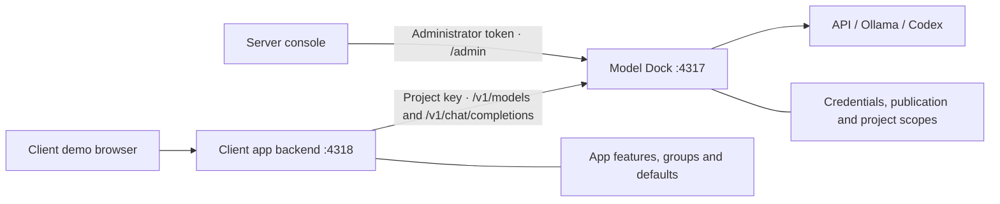

# Architecture and extraction boundaries

One repository contains independently replaceable protocol, core, provider, gateway, server console and client demo modules. Runtime imports are relative and the npm package includes all required modules; the source blog is not required at install or runtime.

## Request ownership

1. HTTP validates loopback Host/Origin and authenticates a scoped project token or the administrator.
2. Core validates the text request, resolves a model/alias to its connection, checks enabled/available state and key scope, and reserves bounded capacity.
3. The provider emits delta, usage and terminal events. It owns upstream protocol translation and cancellation.
4. HTTP formats either Chat Completions JSON or SSE. The API caller owns function execution.

A model's identity is `connectionId/nativeModelId`. Two connections to the same model name remain separate. Existing aliases are retained for compatibility; new application functions live in the consuming app. Removing a connection leaves its aliases visibly unavailable; it never points them at another provider. New discovery does not enable models or grant key permissions.

Connection URL changes disable existing model entries until discovery or manual registration. Calls already dispatched retain their captured provider/configuration; key revocation and connection removal also cancel in-flight requests. Ordinary model disabling applies to new requests.

The local process is a single trusted operator service. Project keys scope inference only; they cannot access management APIs. Multi-user ownership is deliberately not approximated using frontend state. A future hosted coordinator must introduce tenant ownership and credential scopes explicitly.

## Persistence

`Store` owns the JSON schema, revision checks, encrypted upstream credentials, private-file permissions, a single-writer lock and atomic replacement. This is appropriate for a local tool, not a horizontally scaled database. Requests keep bounded metadata in memory; prompts and completions are never written by the gateway.

Adapters receive only their connection's decrypted secret. The console sees `hasKey`, not the secret or encrypted envelope. Scoped project keys are stored as SHA-256 hashes and disclosed only once. The master key is separate from state, but resides in the same private OS account directory; this is disk-file protection rather than hardware-backed key storage.

## What was extracted

- Codex process lifecycle, temporary workdir, reduced environment, RPC dispatch, final-message filtering and usage semantics from `runtimes/local-connector/providers/codex/`.
- Native role history, dynamic-function aliasing and handoff design from `runtimes/platform-ai-sidecars/codex-bridge/`.
- Model capability discovery and loopback-provider separation from the Ollama connector.
- Connection-aware model identity, default-off discovery, revision-checked saves and fail-closed preferences from the blog's model policies.
- The server console manages connections and publication; the independent client demo adapts the reference “functions/models” UI and owns feature preferences.

The blog's accounts, SQLite schema, analytics, billing, content features, images, storage and platform defaults were not imported. The outbound connector is not yet shipped: its device/lease protocol must be extended for streaming before it becomes a public contract.

## Adding a provider

Register a provider in `packages/providers/index.mjs`. Implement:

```js
{
  async discover(connection, { secret, signal }) { /* model metadata[] */ },
  async *generate(connection, request, { secret, signal, model }) {
    yield { type: 'delta', delta: { content: '...' } };
    // Emit usage only when the upstream actually measured it.
    yield { type: 'done', finishReason: 'stop' };
  },
  async close() { /* owned resources only */ }
}
```

An adapter must reject parameters it cannot enforce, propagate cancellation, bound buffers and distinguish a complete result from a disconnected stream. Add isolated HTTP/stdio contract tests before declaring a capability.

## Independent client boundary



`apps/demo` is optional and independently runnable. It does not import the gateway core for normal operation: its backend uses the public project-scoped HTTP API. Only explicit `--mock` mode starts a separate temporary gateway with deterministic providers. No production account or provider is read by that mock fixture.

The app caches authorized metadata, keeps its own function catalog and validates single/multiple selections and reasoning inheritance before building a native model request. The gateway independently enforces its current publication, key scopes, capacity and provider constraints on every call. A cached selection is never an authorization grant. Missing models remain visibly unavailable, and invalid defaults never trigger fallback. Cancellation propagates through the client backend to the gateway.

The demo has a separate private directory, session token, single-writer lock and revision-checked atomic store. The browser only receives safe metadata and preferences. Its project key remains in the backend's private `client.json` file (not encrypted). Both UI views share a per-tab draft with conflict preservation. See [client setup](client-demo.md) and [preferences](model-settings.md).

## Compatibility and schema v2

Server `/admin/model-settings` now accepts publication flags only: complete `{id, enabled}` model rows. Application routes, groups and reasoning preferences are rejected there. New global business aliases are rejected by `POST /admin/routes` with `410 client_owned_settings`; existing aliases, scopes and saved policies remain compatible. The administrator state API lists these aliases, and the administrator API supports deletion.

Schema v2 preserves optional legacy model `reasoningPolicy`/`groupPolicies` and route `group`/`reasoningPolicy`. On the first open of a valid v1 directory, the store verifies its private identity, writes a private `state.v1.<id>.backup.json`, then atomically writes v2 with an incremented revision. Existing connections, encrypted secrets, keys, publication flags and alias targets are retained. Migration introduces no access grants. Unsupported or damaged schemas fail closed; restore a complete matching directory backup before using an older binary.

Legacy reasoning policies continue to constrain old calls and fail closed if discovery invalidates their saved levels. New app preferences are kept entirely in the client store and sent as explicit request parameters. The client does not automatically import administrator configuration or legacy aliases.
